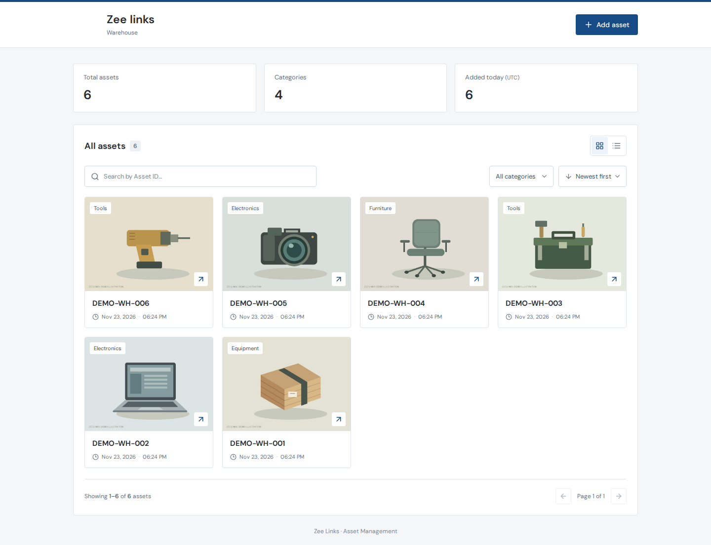
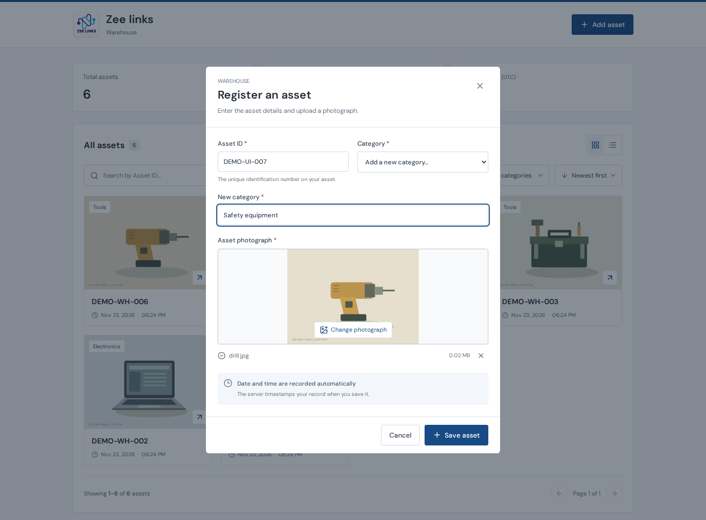
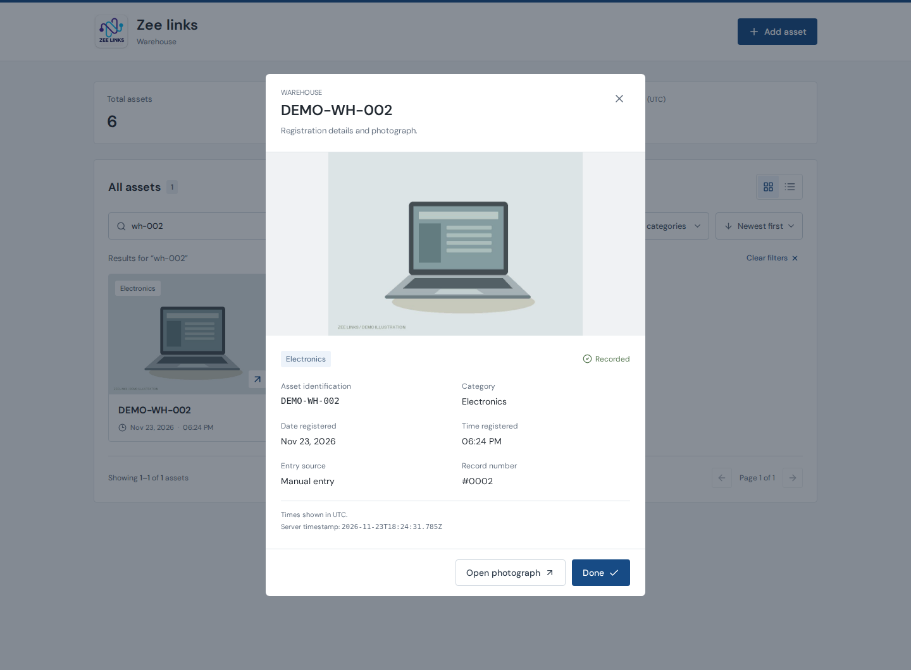
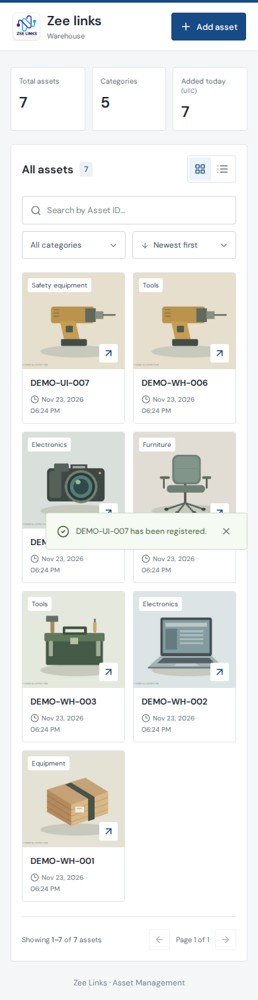

# Zee Links — Warehouse Asset Register

A small on-premises asset registration prototype built with **React, FastAPI, and SQLite**. An operator enters an Asset ID and category, uploads a photograph, and finds saved records in a responsive dashboard. The Python server generates every creation timestamp and stores records in SQLite.

## Features

- Register an Asset ID, category (including custom categories), and photograph.
- Server-generated UTC creation date and time; device-local display in the dashboard.
- Case-insensitive, unique Asset IDs; duplicate records return a clear error.
- Search by all or part of an Asset ID; filter by category, sort, and paginate.
- Grid and list views, individual record details, and full photograph viewing.
- Responsive mobile layout, keyboard-accessible dialogs, loading, empty, and error states.
- JPG, PNG, and WebP validation by decoding actual image bytes. Limit: 8 MB and 25 megapixels; animated images are rejected.
- Images are oriented, resized to fit 1600 × 1600, converted to JPEG, and stripped of metadata. Originals are not retained.
- FastAPI's interactive API documentation at `/docs`.
- The same REST endpoint supports manual and automated sources.

## Screenshots

### Desktop dashboard



### Register an asset



### Asset details



### Mobile dashboard



## Requirements

- Python **3.12 or newer** (tested with 3.14).
- Node.js **22.12 or newer** and npm, used to build/develop the React frontend.
- No separate database server or cloud account.

The backend runs entirely in Python. Once the frontend is built, the warehouse server only needs Python and the `dist/` directory to serve the application.

## Quick start

Run these commands from the project root.

### 1. Install dependencies

```bash
python3 -m venv .venv
source .venv/bin/activate
python -m pip install -r requirements.txt
npm ci
```

On Windows, use `python` instead of `python3`, and activate with `.venv\Scripts\Activate.ps1` in PowerShell or `.venv\Scripts\activate.bat` in Command Prompt.

### 2. Build and start

```bash
npm run build
python -m uvicorn server.app:app --host 0.0.0.0 --port 3001
```

Open **http://localhost:3001**. The database and upload directory are created automatically. The register starts empty; add your own records or load the optional demo below. Restart the server after building a frontend for the first time, because FastAPI mounts `dist/` at startup.

### 3. Optional demo records

With the server running, open a second terminal:

```bash
source .venv/bin/activate
python scripts/seed.py
```

This adds six records with `DEMO-` IDs and bundled original illustrations. It skips existing demo IDs and works offline. These are demonstration records; they are not real inventory or real asset photographs. Their timestamps reflect when the seed API calls run. Run the demo against a separate `DATA_DIR` if you want to keep real inventory empty.

## Development

Use two terminals:

```bash
# Terminal 1: Python backend
source .venv/bin/activate
python -m uvicorn server.app:app --host 0.0.0.0 --port 3001 --reload
```

```bash
# Terminal 2: React frontend
npm run dev
```

Open **http://localhost:5173**. Vite proxies `/api` and `/uploads` to FastAPI on port 3001. The frontend uses relative URLs, so it also works from another device. No permissive CORS policy is needed.

## Access from other warehouse devices

1. Run the production build and FastAPI command on the warehouse computer.
2. Connect phones/tablets/computers to the same reachable LAN or Wi-Fi network.
3. Find the warehouse computer's IPv4 address (`hostname -I` on Linux, `ipconfig` on Windows).
4. Open `http://<warehouse-ip>:3001` on another device, for example `http://192.168.1.50:3001`.
5. If needed, allow inbound TCP port 3001 on the warehouse computer's firewall **for the trusted local network**. Wi-Fi client isolation can also prevent access.

`0.0.0.0` is a bind address, not a URL to type into a phone. `localhost` on a phone refers to the phone itself. A reserved LAN address for the server makes the link predictable. For development access use port 5173; for the built application only port 3001 is needed.

The frontend, fonts, SQLite database, and uploaded photographs are local. The header uses the official Zee Links logo at `https://zeelinks.com.pk/assets/logo/logo.png`, which requires internet access. Dependency installation requires internet or a prepopulated package cache. FastAPI's optional Swagger documentation UI loads its UI assets from a CDN.

## Architecture and workflow

```text
Warehouse phone / computer
        │  HTTP, same LAN
        ▼
FastAPI / Uvicorn on warehouse computer
        ├── /              → built React dashboard (dist/)
        ├── /api/assets    → validated asset records
        ├── /uploads/      → normalized JPEG photographs
        └── SQLite         → data/assets.sqlite
```

1. React builds a `multipart/form-data` request from the form.
2. FastAPI validates the fields and rejects duplicate IDs.
3. Pillow decodes and normalizes the photograph. A UUID filename prevents user-controlled filesystem paths.
4. FastAPI generates a UTC timestamp and inserts the row using parameterized SQL.
5. The API returns the saved record. React refreshes the dashboard and shows a confirmation.
6. Search and filters run on the server; the frontend requests one page at a time.

SQLite is appropriate for a single on-premises prototype: zero database service setup, durable storage, and straightforward backups. WAL mode and a five-second lock timeout support modest concurrent use. The database enforces ID uniqueness, including simultaneous submissions. Each request owns its database connection. If insertion fails after saving an image, the new image is removed.

### Data model

| Column | Purpose |
| --- | --- |
| `id` | Internal integer primary key; used to retrieve an individual record |
| `asset_id` | Operator identification number; unique with case-insensitive ASCII comparison |
| `category` | Trimmed category, 1–60 characters |
| `photo_filename` | Unique generated JPEG filename; the file is stored outside the database |
| `created_at` | Server-generated ISO 8601 UTC timestamp |
| `source` | `manual` or `automated` |

Asset IDs are 1–80 characters and start with a letter or number. Letters, numbers, spaces, dots, underscores, dashes, and slashes are allowed. Search treats `%`, `_`, and backslashes literally, rather than as SQL wildcard characters. “Added today” counts UTC dates; individual dates/times use the device's time zone.

## REST API

| Method | Endpoint | Purpose |
| --- | --- | --- |
| GET | `/api/health` | Verify the API and database are reachable |
| GET | `/api/assets` | List/search/filter records and get summary statistics |
| POST | `/api/assets` | Create a record with a required photograph |
| GET | `/api/assets/{id}` | Retrieve one record by its internal numeric ID |
| GET | `/uploads/{filename}` | Retrieve a saved photograph |
| GET | `/docs` | Interactive OpenAPI documentation |

### Create a record

```bash
curl -X POST http://localhost:3001/api/assets \
  -F 'assetId=WH-0042' \
  -F 'category=Equipment' \
  -F 'photo=@/path/to/photo.jpg' \
  -F 'source=manual'
```

Successful response: **201 Created**, with a `Location` header:

```json
{
  "id": 1,
  "assetId": "WH-0042",
  "category": "Equipment",
  "photoUrl": "/uploads/6a010661-e0b3-4e5d-a15b-d705c40aec92.jpg",
  "createdAt": "2026-11-23T12:30:00.000Z",
  "source": "manual"
}
```

Errors use FastAPI's `detail` field: **400** for invalid images/field content, **409** for duplicate IDs, **422** for missing or incorrectly typed fields, and **404** for missing records. The frontend displays readable messages.

### Search, category, pagination, and sort

```text
GET /api/assets?q=WH-&category=Equipment&page=1&limit=12&sort=newest
```

`q` is a case-insensitive partial Asset ID search. `category` is an exact category match. `limit` is 1–100, `page` starts at 1, and `sort` is `newest` or `oldest`. The response includes `items`, matching `total`, `page`, `limit`, `totalPages`, global `stats`, and category counts. No matches returns an empty list.

## Future automated data collection

Automation does not need to interact with React. A camera, scanner service, or another warehouse system can send the same multipart request with `source=automated`. The database and dashboard already retain and display this source. Clients supply the Asset ID, category, and photograph; the server remains responsible for creation timestamps.

A runnable standard-library Python example is included:

```bash
python scripts/submit_asset.py \
  --url http://192.168.1.50:3001 \
  --id AUTO-0042 \
  --category Equipment \
  --photo /path/to/captured.jpg
```

Treat a duplicate response as a conflict to inspect; this prototype records each Asset ID once. A larger automated system could add authenticated device identities, an external event ID for retry deduplication, a separate capture timestamp, and a job queue without replacing the dashboard. PostgreSQL and shared image storage would be the next steps if deployment grows beyond a single warehouse server.

## Storage and backups

Default persistent files:

```text
data/
  assets.sqlite
  assets.sqlite-wal   # may exist while running
  assets.sqlite-shm   # may exist while running
  uploads/
    <uuid>.jpg
```

Set `DATA_DIR` to an absolute storage path to relocate them:

```bash
DATA_DIR=/path/to/warehouse-data python -m uvicorn server.app:app --host 0.0.0.0 --port 3001
```

On PowerShell: `$env:DATA_DIR = 'C:\warehouse-data'` before starting Uvicorn. `.env.example` documents the variable; the application does not automatically load `.env` files.

For a simple consistent backup, **stop the server, copy the entire data directory, then restart it**. Preserve both the database and uploads. Restore by stopping the server and placing the backed-up directory at `DATA_DIR`. Do not copy only the main SQLite file while WAL writes are active.

## Verification

```bash
source .venv/bin/activate
python -m pip install -r requirements-dev.txt
python -m pytest -q
npm run build
npm run format:check
```

The 23 API tests cover creation, automatic timestamps, photograph retrieval and resizing, unsupported/corrupt/oversized images, validation, duplicate and concurrent IDs, search literal handling, category filters, pagination, sorting, automated sources, persistence across app restart, API documentation, and missing records.

## Project layout

```text
client/src/
  main.jsx                 Dashboard, search, filters, grid/list views
  components/              Register form, details, accessible modal
  lib.js                   API errors and timestamp formatting
  styles.css               Responsive dashboard styling
server/
  app.py                   FastAPI routes, image validation, static serving
  database.py              SQLite schema, connections, serialization
scripts/
  seed.py                  Optional demonstration records via the API
  submit_asset.py          Example automated Python client
  generate_demo_images.py  Reproducible offline demo illustrations
  browser-check.mjs        Browser workflow checks
tests/test_api.py         API and persistence tests
docs/demo/                Bundled demo illustrations
screenshots/              Dashboard, form, detail, and mobile images
```
